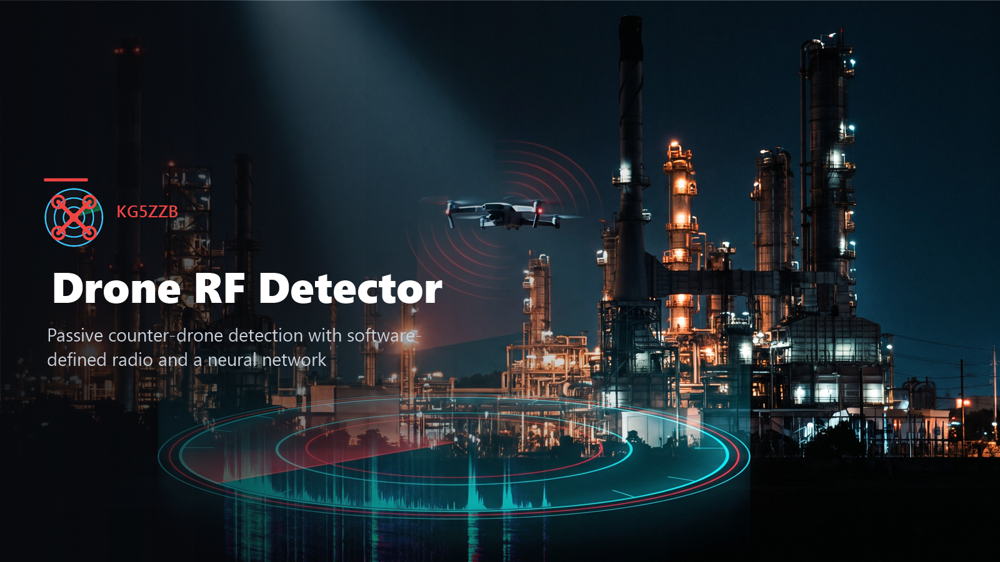
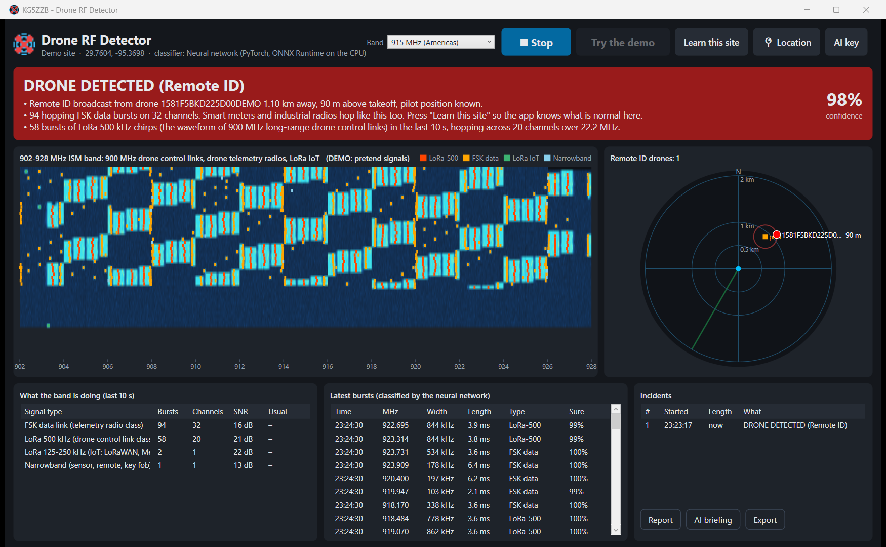

# KG5ZZB - Drone RF Detector



[](https://www.linkedin.com/in/jeypnet/)


**Passive drone detection for Windows with a low-cost RTL-SDR: a neural network classifies 900 MHz radio bursts in real time, and FAA Remote ID broadcasts are decoded over Bluetooth.**

The app sweeps the 902-928 MHz band (or 868 / 433 MHz), finds every RF burst in the spectrogram, and a small PyTorch-trained neural network, running on the CPU with ONNX Runtime, sorts each burst into a signal class. When the classes that drone radio links use show up repeatedly *and* hop across channels, the app raises an alert, compares it with what the site normally hears, and logs an incident. Drones that broadcast **Remote ID** appear on a radar-style plot with their pilot's position.

It is **receive-only**: it never transmits, jams or interferes with anything.



> **Status: v0.1.0.** Sweep engine, burst detector, neural-network classifier, site baseline (anomaly detection), alert logic, Bluetooth Remote ID decoder, incident log with CSV/JSON export, plain-language and optional AI-written reports, and a built-in demo all work. 22 automated tests.

---

## What it does

### 📡 Finds drone radio links in the 900 MHz band
- **Sweeps** 902-928 MHz in 2 MHz steps (13 steps, about 2 s per sweep) with an RTL-SDR at 2.4 MS/s.
- **Detects bursts** in a short-time FFT spectrogram (256-point, 9.4 kHz bins, 107 µs frames): per-bin noise floor, threshold, connected-component labelling, and fragment merging.
- **Measures each burst**: centre frequency, bandwidth, duration, SNR, chirp score, upward-step ratio, instantaneous width and peak spread.
- **Classifies each burst with a neural network** into five classes:

| Class | Typical source |
|---|---|
| LoRa 500 kHz chirps | 900 MHz long-range drone control links (for example ExpressLRS) |
| FSK data packets | Drone telemetry radios and other frequency-hopping data links |
| LoRa 125-250 kHz | LoRaWAN sensors, Meshtastic and other IoT |
| Narrowband OOK/FSK | Weather sensors, remotes, key fobs, meters |
| Noise / spur | Carriers, clicks, noise peaks |

### 🧠 Raises an alert only on behaviour, not on one burst
- A drone link **hops**: many bursts per second on many channels. The alert needs repeated drone-link-class bursts across at least 3 channels in a 10 s window.
- **Hopping FSK alone is treated with care:** 900 MHz smart meters and industrial radios hop with FSK too, so FSK-only activity stays at WATCH unless it is dense (telemetry-link rate) and above the learned site baseline.
- **Learn this site** (2 minutes) records how much of each class the site normally hears (a LoRaWAN gateway, an industrial hopping radio, utility meters). Later activity is compared with that baseline, so normal equipment does not cause false alarms.
- The banner shows **CLEAR / WATCH / ALERT** with a confidence score and the reasons in plain English.

### 🛰️ Decodes FAA Remote ID (ASTM F3411) over Bluetooth
- Uses the PC's own Bluetooth adapter (Windows BLE advertisement watcher), service data UUID `0xFFFA`.
- Decodes **Basic ID** (serial number, aircraft type), **Location/Vector** (position, height, speed, heading), **System** (pilot position) and **Operator ID**, including Bluetooth 5 message packs. Byte layouts follow the [opendroneid-core-c](https://github.com/opendroneid/opendroneid-core-c) reference implementation.
- A drone inside the alert radius (default 1.5 km) is an **ALERT**; its track and its pilot appear on the radar plot.

### 📋 Incidents, reports and integration
- Each alert becomes an **incident** that closes after 30 quiet seconds. Every closed incident is appended as one **JSON line** to `%APPDATA%\KG5ZZB-Drone-RF-Detector\incidents.jsonl`, ready for a SIEM, a SCADA historian or a script.
- **Export** writes all incidents as CSV and JSON.
- **Report** writes a plain-language summary offline.
- **AI briefing (optional):** with an Anthropic API key, Claude writes a short briefing for a security supervisor from the incident summary. No radio data is sent. The key is stored encrypted for the Windows user (DPAPI).

### 🎬 Try it without hardware
**Try the demo** (or start with `--demo`) plays a built-in site scenario: LoRaWAN sensors, a Meshtastic node, an industrial hopping radio, utility meters and a 433 MHz weather sensor. After 25 seconds a drone arrives with a LoRa 500 kHz control link, an FSK telemetry radio and a Remote ID broadcast, circling about 1 km away.

---

## How the neural network is built

```
DatasetGen (C#)            train.py (Python, PyTorch)              App (C#, ONNX Runtime)
render training RF   ->    standardise 8 features                  embedded burst_classifier.onnx
run the app's real   ->    8 -> 32 -> 32 -> 5 MLP, class weights   CPU inference, microseconds per burst
burst detector             early stopping, held-out test set  ->   export ONNX + model card
```

- **Data:** a C# dataset generator renders LoRa chirp packets (SF6-SF10, 125/250/500 kHz), 2-FSK packets (32-128 kbit/s), OOK pulse trains, narrow FSK, carriers and clicks into 60 ms captures with noise (SNR 6-30 dB), then runs the **same spectrogram and detector the app uses**, so the network learns from exactly what it sees live.
- **Training:** a PyTorch training script: cross-entropy with class weights, Adam, early stopping on a validation split, test on a separate seed.
- **Result on the held-out test set:** **96.4% accuracy, macro F1 0.965**, against 66.1% / 0.420 for a simple hand-written rule baseline. Per-class numbers and the confusion matrix are in **[docs/MODEL.md](docs/MODEL.md)** (the model card).

## Architecture

| Layer | What it does |
|---|---|
| Hardware | P/Invoke bindings to librtlsdr, async streaming, retune with stale-buffer discard, USB error retries |
| Sweep | Tunes across the band, collects 150 ms dwells, runs the pipeline per dwell |
| DSP | Short-time FFT, noise floor, thresholding, connected components, burst features |
| Machine learning | Training-data pipeline, PyTorch training, ONNX export, ONNX Runtime inference, rule baseline |
| Decision | Sliding window, frequency-hopping test, site baseline, CLEAR / WATCH / ALERT |
| Remote ID | ASTM F3411 decoder, tracker, Windows Bluetooth LE watcher |
| Incidents | Incident lifecycle, JSON Lines log, CSV/JSON export, template report, optional Claude briefing |
| Demo engine | LoRa / FSK / OOK signal generation, demo scenario, demo dongle |
| UI | WPF: verdict banner, full-band waterfall with classified ticks, Remote ID radar plot, tables |

## Requirements
- Windows 10 or 11, 64-bit.
- An RTL-SDR dongle (RTL2832U + R820T/R828D tuner) with the WinUSB driver (install once with [Zadig](https://zadig.akeo.ie/)). Tested with a Nooelec NESDR SMArt v5.
- Bluetooth (optional) for Remote ID.

## Recommended hardware

| Item | What to use | Why |
|---|---|---|
| **SDR dongles** | **1** RTL-SDR is enough: the app sweeps 902-928 MHz by itself. | A **2nd dongle** is optional: it lets one dongle watch 902-928 MHz and the other 433 MHz at the same time instead of alternating. |
| **Antenna** | A **900 MHz antenna** (quarter-wave elements about 8 cm long), or a **wideband discone** (about 25 MHz to 1.3 GHz). | The discone also covers 433 and 868 MHz, so one antenna serves every band the app sweeps. Mount it high and clear of metal for the best range. |
| **Coax** | Short, low-loss coax (for example RG-6 or LMR-240 class) between antenna and dongle. | At 900 MHz long thin coax loses a lot of signal. |
| **Bluetooth** | The PC's built-in Bluetooth, or any USB Bluetooth adapter. | Receives FAA Remote ID broadcasts. An adapter with Bluetooth 5 Long Range support can hear BT5 Remote ID too. |
| **Optional** | A 900 MHz band-pass filter or LNA. | Helps near strong cellular or broadcast transmitters. |

Direction finding (pointing at the drone) would need several phase-coherent receivers, such as a KrakenSDR; this app detects and classifies with a single receiver.

## Scope
- A signal class is a **waveform family**, not a product. A LoRa 500 kHz link may belong to a drone or to other equipment.
- An RTL-SDR covers about 24 MHz to 1.7 GHz, so the 2.4 GHz and 5.8 GHz links that many consumer drones use are out of range. Remote ID still identifies compliant drones in those bands.
- Windows' Bluetooth stack reports legacy (Bluetooth 4) advertisements; Bluetooth 5 Long Range Remote ID depends on the adapter and driver.
- Detection only. In the US, jamming or taking over a drone is illegal for private parties.

## Source code
This repository is the public showcase: description, results, model card and images.
The source code is private. Technical walkthroughs are available on request.

## Contact
Into ham radio, RF, SDR or aviation? **[Let's connect on LinkedIn](https://www.linkedin.com/in/jeypnet/)**. I share new radio apps, RF projects and what I learn along the way.

## License
Copyright (c) 2026 KG5ZZB. All rights reserved. Text and images may not be reused without permission.
